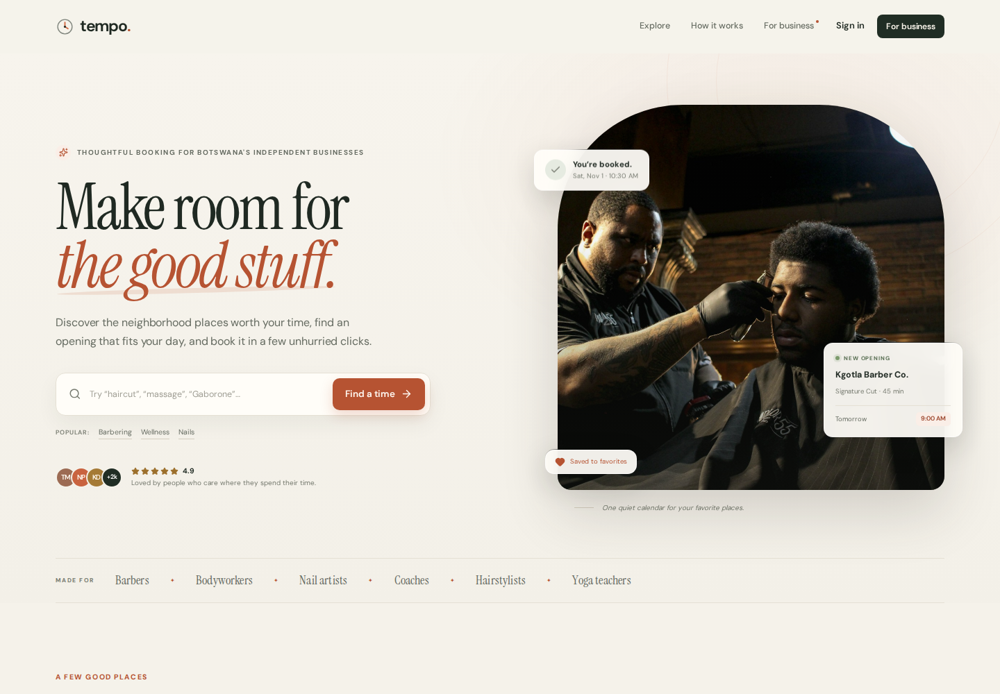
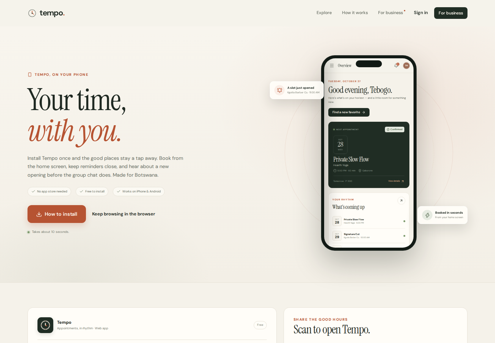
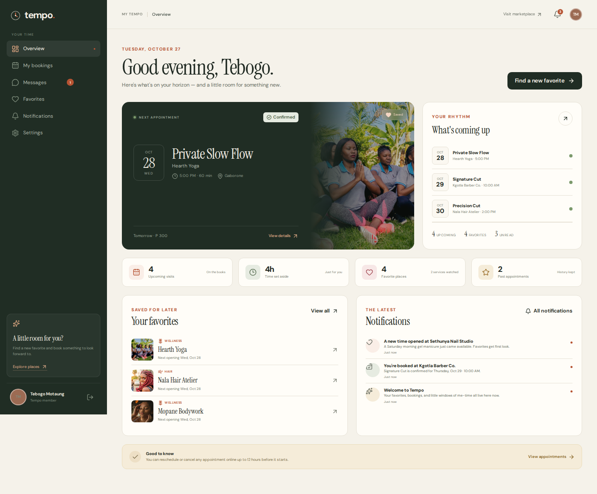
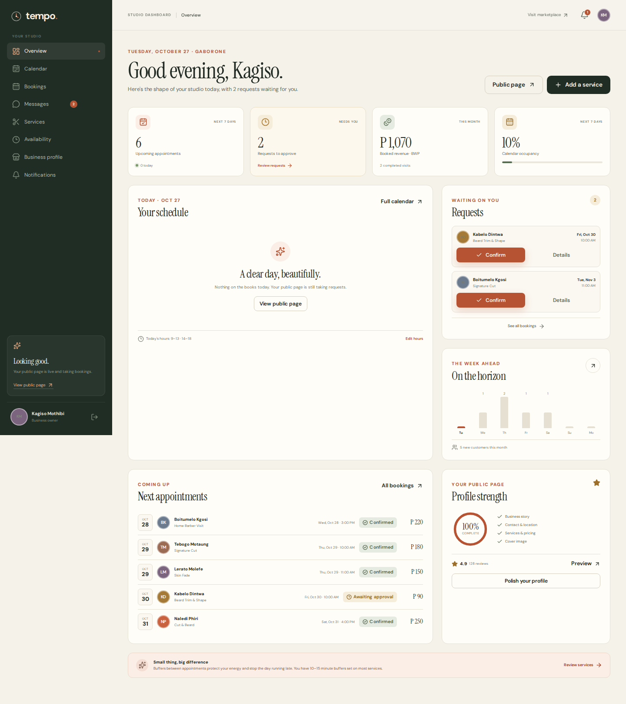
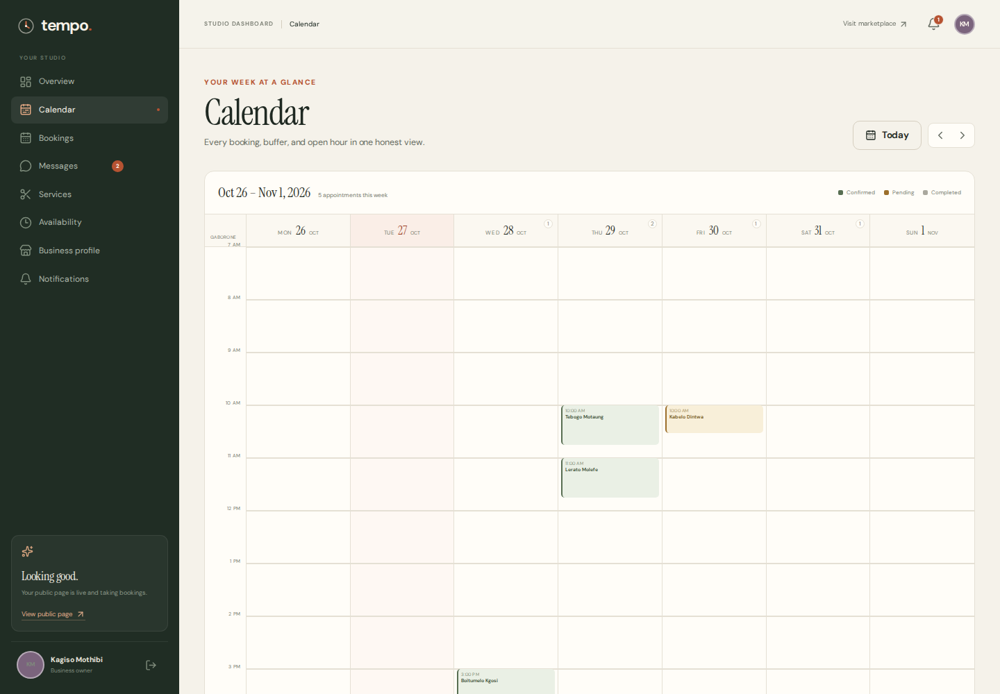
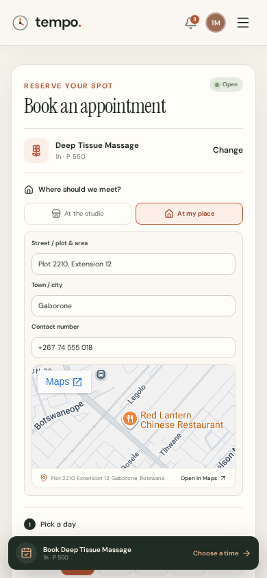
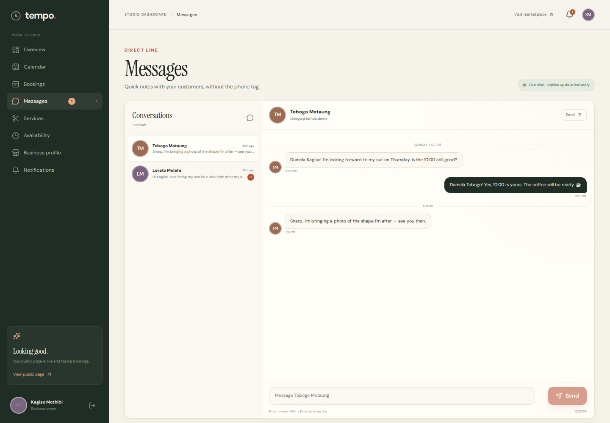
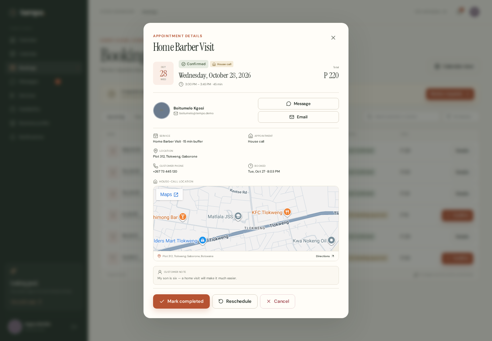
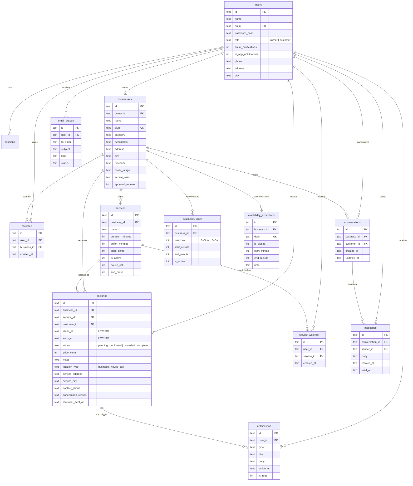

# Tempo — appointments across Botswana

A full-stack appointment booking app built for Botswana's independent businesses and their customers. Tempo
handles the unglamorous parts — BWP pricing, working hours, date exceptions, buffers, house calls, Google Maps,
double-booking, approvals, reminders, waitlist alerts, and instant messaging — inside a calm, responsive
interface.

**Built by Verge Dynamics.**



## Install it like an app

Tempo is a **progressive web app**. It installs from the browser — there is no app-store download, account, or build step for customers.

- **Android / Chrome:** use the in-app install prompt, or Chrome menu → **Install app**.
- **iPhone / iPad:** open the site in Safari → **Share** → **Add to Home Screen**.
- **Desktop:** use the install icon in Chrome/Edge's address bar.

The dedicated install page at **`/get-app`** includes platform-specific instructions, an install button when the browser exposes the native prompt, and a QR code for opening the app on another device. The app ships with a web manifest, maskable icons, an offline fallback, and a small service worker for an app-shell cache. Installation requires HTTPS in production (or `localhost` during development).

## Live review

**Public review link:** https://mailto-experience-perceived-contributions.trycloudflare.com  
**Mobile install page:** https://mailto-experience-perceived-contributions.trycloudflare.com/get-app

The review deployment runs from an isolated production database (`data/review.db`) and is served through a
temporary HTTPS tunnel. It is intended for review only and stays online while the review server is running.
Use **Install** in Chrome, or on iPhone open in Safari → **Share** → **Add to Home Screen**.

---

## Feature tour



### For business owners

- Edit a public business profile: name, story, category, cover, accent color, address, contact details and
  IANA timezone.
- Manage services with duration, price in **BWP Pula**, buffer/reset time, and an optional **house-call** offering.
- Set recurring weekly availability, including split shifts (for example, a lunch break), and add date-specific
  exceptions for days off or holiday hours.
- View bookings in a week calendar with real time blocks, or as a searchable/filterable list.
- Confirm pending requests, complete visits, reschedule, or cancel. Customers are emailed for every change.
- Toggle manual approval per business. If enabled, new bookings are held as `pending`; otherwise they are
  confirmed instantly.
- Get an in-app + email alert whenever a new booking request arrives.
- Reply to customers directly from the Messages inbox or from any booking.
- See the business on Google Maps, and see each customer's house-call address on a map before travelling.

### For customers

- Browse and search Botswana businesses by name, service, category, town, or neighborhood.
- View services and only genuinely available slots, computed from the owner's hours minus existing bookings
  and buffers.
- Book at the studio or request a house call, with your saved address and phone number prefilled.
- Reschedule or cancel online up to 12 hours before the appointment.
- Favorite businesses and optionally watch individual services for new openings.
- Message the business in a live thread — no need to leave the app for email or phone tag.
- Install Tempo to a phone or desktop home screen as a progressive web app.
- Receive in-app and email confirmations, reminders, and alerts when a cancellation opens a slot at a favorite.
- Manage upcoming and past appointments from a personal dashboard, and control notification preferences.

### Under the hood

- Session-based authentication with two roles (`owner`, `customer`), scrypt password hashing and HTTP-only
  session cookies.
- SQLite relational database (Node's built-in `node:sqlite`), with foreign keys, indexes, and unique indexes.
- Server-side slot validation inside a `BEGIN IMMEDIATE` transaction, plus unique indexes as a second line
  of defense against double-booking.
- Email delivery through SMTP when configured; otherwise a safe demo outbox (`email_outbox` + `data/emails/`)
  so every message can be previewed in the UI.
- Background reminder scan at startup and every 60 seconds. Reminders are sent at most once per booking.
- Google Maps embeds for business locations and house-call addresses; no Maps JavaScript API key is required for
  the embedded maps.
- Business ↔ customer conversations with unread counts, access checks, and near-instant polling.
- 10 automated tests covering slot generation, buffers, date exceptions, double-booking, house-call validation,
  rescheduling, cancellation alerts, and reminders.

---

## A look inside

| Customer dashboard | Owner studio |
| --- | --- |
|  |  |

| Owner calendar | Mobile house-call booking |
| --- | --- |
|  |  |

| Instant messages | House-call map |
| --- | --- |
|  |  |

---

## Quick start

### Requirements

- **Node.js 22.13+** (Node 24 recommended — Tempo uses the built-in `node:sqlite` module)
- npm 10+

### Run it

```bash
npm install
npm run dev
```

Open **http://localhost:4200**.

The database and demo data are created automatically on first run at `data/tempo.db`. Images are bundled
locally in `public/images/`, so the app works without third-party image CDNs.

### Demo accounts

All demo accounts use the password **`demo1234`**.

| Role | Email | What to look for |
| --- | --- | --- |
| Business owner | `kagiso@tempo.demo` | Kgotla Barber Co., 6 services, 9 bookings, 2 pending requests, house-call booking, messages |
| Customer | `tebogo@tempo.demo` | 4 upcoming appointments, favorites, watched services, a house-call booking, unread messages |

The sign-in page also has one-click demo buttons for both roles. Other seeded customers:
`lerato@tempo.demo`, `kabelo@tempo.demo`, `naledi@tempo.demo`, `boitumelo@tempo.demo` (all `demo1234`).

### A nice 90-second demo route

1. Sign in as **Tebogo** (customer) and open **Explore** → **Mopane Bodywork**.
2. Keep **Deep Tissue Massage** selected, choose **At my place**, check the Google Maps preview, and request a
   house call. The address and phone number prefill from the profile.
3. Open **Messages** and continue the conversation with Mopane Bodywork. The seeded thread includes a house-call
   question.
4. Sign in as **Kagiso** (owner). Open **Messages** to reply to Tebogo and Lerato, or open **Bookings** →
   **Home Barber Visit** to see a customer's house-call address on Google Maps.
5. Sign in as **Lerato**, cancel the Skin Fade appointment. Tebogo (who favorited Kgotla Barber Co.) receives a
   “new time opened” notification and email.
6. As the owner, try editing weekly hours, adding a day off, creating a service, and toggling house calls.

### Scripts

| Command | What it does |
| --- | --- |
| `npm run dev` | Express API + Vite middleware, with HMR, on port 4200 |
| `npm run build` | Builds the client to `dist/` |
| `npm start` | Production server serving `dist/` and the API |
| `npm run seed` | Seeds demo data only if the database is empty |
| `npm run seed -- --reset` | ⚠️ Deletes all data, then re-seeds the demo |
| `npm test` | Runs the Node test suite (10 tests) |
| `npm run typecheck` | Full TypeScript check for client + server |

### Configuration

Copy `.env.example` to `.env` if you want to change defaults:

```env
PORT=4200
DATABASE_PATH=./data/tempo.db
APP_URL=http://localhost:4200

# Optional real email delivery. Without SMTP, messages go to the demo outbox.
SMTP_HOST=
SMTP_PORT=587
SMTP_USER=
SMTP_PASS=
SMTP_FROM="Tempo <hello@tempo.local>"
```

`APP_URL` is used for links inside emails. If SMTP is not configured, every email is still rendered and stored
in the database and in `data/emails/`, and can be previewed from **Notifications → Email deliveries**.

---

## Availability algorithm

The availability engine lives in [`server/slots.ts`](server/slots.ts) and is intentionally explicit.

For a requested service, date, and business timezone:

1. **Start with recurring weekly hours** (`availability_rules`). A day can have multiple windows, e.g.
   Tuesday 09:00–13:00 and 14:00–18:00.
2. **Apply date exceptions** (`availability_exceptions`) with full precedence:
   - closed all day → no slots;
   - custom hours → use that single window instead of the weekly rule.
3. **Generate 15-minute candidate starts** inside each window. A candidate must fit the full service duration
   before closing time. Same-day candidates must be at least 30 minutes in the future.
4. **Load live bookings** for the business (`pending` and `confirmed`) and block every candidate whose
   `[start, start + duration + service buffer)` overlaps an existing
   `[booking start, booking end + existing service buffer)`.
5. Return the remaining times. The UI groups them into morning, afternoon, and evening.

This means a 45-minute service with a 10-minute buffer needs **55 minutes of clear calendar**, and two
appointments can’t be stacked so tightly that the provider gets no reset. Pending bookings hold their slots
while awaiting approval.

### Double-booking protection

Booking creation and rescheduling both:

1. Validate the requested `startsAt` against a freshly computed slot list **before** writing.
2. Recompute and re-validate **inside a `BEGIN IMMEDIATE` SQLite transaction** so concurrent requests cannot
   both pass.
3. Rely on two partial unique indexes as a safety net:
   - one live booking per `(service_id, starts_at)`;
   - one live booking per `(business_id, starts_at)`.

A lost race returns HTTP `409` with a friendly “that time was just taken” message; the client clears the choice
and reloads availability.

### Cancellation + waitlist alerts

When an appointment is cancelled:

- The booking becomes `cancelled` and the slot immediately disappears from the owner’s busy set.
- The cancellation is recorded and notification receipts are sent to the customer/owner as appropriate.
- The freed time is recomputed. If it is genuinely open again, Tempo finds:
  - customers who favorited the business, and
  - customers watching that specific service.
- Each matching customer receives an in-app notification (if enabled) and email (if enabled), with the exact
  freed time and a direct link to the business. The person who cancelled is excluded.

### Reminders

A background scan runs two seconds after startup and then every 60 seconds. It selects `confirmed` bookings
starting within the next 24 hours whose `reminder_sent_at` is null, sends an in-app + email reminder according
to preferences, and stamps the booking so it never sends twice.

### BWP pricing

All money values are stored as integer **thebe** (1/100 Pula) and rendered as **Pula** using the `en-BW` locale
and a `P` prefix, for example `P 550`. This applies to public service menus, booking summaries, owner revenue,
emails, and payment snapshots. The seeded prices are realistic Botswana service prices, not converted US
dollars.

### House calls + Google Maps

A service can be marked **Offer house calls** in the owner's service editor. When a customer selects such a
service:

1. They choose **At the studio** or **At my place**.
2. For house calls, the address, town, and contact phone prefill from their saved profile.
3. A Google Maps preview is shown while they type, and the exact address is saved onto the booking as a
   snapshot.
4. The owner sees a **House call** badge in the booking list and a Google Maps panel inside the booking detail,
   along with the customer's contact number.

Business profiles also embed a Google Maps view of the business address. The maps use Google Maps' keyless
`output=embed` URL; no Maps API key or billing account is needed for this demo. The map footer always includes an
**Open in Google Maps** link.

### Instant messaging

Customers and owners share a per-business conversation. The messaging layer includes:

- `conversations` (one per business/customer pair) and `messages`.
- Inbox thread list with last message, relative time, and unread count.
- Optimistic-feeling send, automatic scroll, and a 2.5-second polling refresh while a thread is open.
- Role-aware access checks: customers only see their own threads; owners only see threads for their business.
- Owners can start a conversation from a booking; customers can start one from any business page.
- Unread-message badges in the sidebar, refreshed on navigation and every 10 seconds.
- Read receipts are recorded when the recipient opens the thread.

Polling keeps the demo deployable on a single Node process without an extra WebSocket service. A production
version could replace the refresh loop with SSE or a managed realtime channel without changing the data model.

### Timezones

Availability is defined in the business's local IANA timezone, converted to UTC for storage and comparisons.
The Botswana seed data uses `Africa/Gaborone` (CAT, GMT+2). Every booking response includes the business
timezone, and customer-facing slot pickers show an explicit “All times in Botswana time (CAT)” note. Luxon
handles timezone conversion and DST where relevant.

---

## Data model



Additional tables: `sessions` (opaque hashed session tokens), `conversations`/`messages` (chat), and `email_outbox` (SMTP/dev delivery audit and in-app email preview). Schema and lightweight additive migrations are in [`server/schema.ts`](server/schema.ts).

---

## Tech stack

| Layer | Choice |
| --- | --- |
| Client | React 19, React Router, Vite, TypeScript, plain modern CSS, Lucide icons |
| Fonts | Instrument Serif + DM Sans Variable, bundled locally |
| Server | Node.js, Express 5, TypeScript (`tsx`) |
| Database | SQLite via built-in `node:sqlite` |
| Auth | scrypt password hashing, opaque HTTP-only session cookies, server-side sessions |
| Validation | Zod |
| Timezones | Luxon |
| Maps | Google Maps Embed (keyless) + map links |
| Messaging | Role-scoped conversation API + 2.5s polling |
| Currency | BWP / Pula, stored in thebe |
| Email | Nodemailer SMTP (optional) + demo outbox fallback |
| Tests | Node test runner |

The Vite client and Express API run behind one port in development via Vite middleware, so there is no proxy
configuration and cookies are same-origin.

## Project structure

```
public/
  manifest.webmanifest  PWA manifest
  sw.js                 App-shell service worker + offline fallback
  icons/                App and iOS touch icons
server/
  index.ts              Express app, Vite middleware, reminder scheduler
  schema.ts             Relational schema
  seed.ts               Schedule-aware demo data
  slots.ts              Availability engine
  booking-service.ts    Booking/reschedule/cancel/reminder domain logic
  notifications.ts      Preference-aware in-app + email notifications
  email.ts              Email templates, SMTP/dev delivery
  auth.ts               Sessions, password hashing, route guards
  serializers.ts        API response mapping
  routes/               auth, public, customer, owner, messages HTTP routes
src/
  pages/                Landing, Explore, Business profile, auth, account, owner, Messages, Get the app
  lib/pwa.ts            Install prompt + service worker registration
  components/           Booking, calendar, dashboard, modal and notification UI
  context/              Authentication and toast providers
  lib/                  API client, formatting, timezones
shared/types.ts         Shared client/server domain types
tests/                  Availability + booking domain tests
```

## API overview

All JSON endpoints are under `/api`; authentication uses the `tempo_session` cookie.

| Method | Endpoint | Purpose |
| --- | --- | --- |
| POST | `/auth/register` | Create customer or owner account |
| POST | `/auth/login` / `/auth/logout` | Session lifecycle |
| GET | `/me` | Current user, including saved address/phone |
| PATCH | `/me` | Update profile and house-call details |
| GET | `/businesses?q=&category=` | Search businesses and services |
| GET | `/businesses/:slug` | Public profile, services, hours, exceptions |
| GET | `/businesses/:slug/slot-days?serviceId=&days=14` | Availability counts per day |
| GET | `/businesses/:slug/slots?serviceId=&date=` | Computed open slots |
| POST | `/businesses/:id/favorite` | Toggle favorite |
| POST | `/services/:id/watch` | Toggle service availability alerts |
| GET | `/me/favorites` | Favorite businesses + watched services |
| POST | `/bookings` | Create a validated studio or house-call booking |
| GET | `/me/bookings?scope=upcoming\|past` | Customer’s appointments |
| PATCH | `/bookings/:id/reschedule` | Customer reschedule (12h policy) |
| PATCH | `/bookings/:id/cancel` | Customer cancellation (12h policy) |
| GET | `/me/notifications` / `/me/emails` | Notification center + email previews |
| PATCH | `/me/preferences` | In-app/email notification preferences |
| GET | `/conversations` | Role-scoped inbox with unread counts |
| GET | `/conversations/unread` | Sidebar unread badge |
| POST | `/conversations` | Start/find a conversation |
| GET | `/conversations/:id/messages` | Thread history; marks incoming messages read |
| POST | `/conversations/:id/messages` | Send an instant message |
| GET | `/owner/overview` | Studio metrics, today, requests, week |
| GET/PUT | `/owner/business` | Business profile |
| GET/PATCH | `/owner/bookings` | Calendar/list and confirm/complete/cancel/reschedule |
| GET/POST/PATCH/DELETE | `/owner/services` | Service management |
| GET/PUT | `/owner/availability` | Weekly availability editor |
| POST/DELETE | `/owner/availability/exceptions` | Date-specific exceptions |

## Tests

```bash
npm test
```

The test suite uses in-memory SQLite databases and covers:

- 15-minute slot generation within weekly hours
- service buffer cool-downs
- closed/custom-hours date exceptions
- adjacent appointments and no phantom blocking
- transactional booking + duplicate rejection (`409`)
- rescheduling with the current booking excluded
- cancellation reopening availability and alerting favorites
- reminders sending exactly once
- house-call address/contact snapshots and missing-address validation

### Manual checks worth doing

- **Double-booking:** open the same business/date in two browsers and book the same slot. The second request
  fails with `409`; the UI refreshes availability.
- **Watcher alerts:** cancel a Kgotla Barber Co. appointment as Lerato, then inspect Tebogo's notification center.
- **Notification preferences:** turn off email for Tebogo, trigger a booking update, and confirm the email is
  skipped while the in-app row is still created.
- **Approval flow:** book at Kgotla Barber Co. (approval on), then confirm as Kagiso and check the customer email.
- **Date exceptions:** add a closed day for the current week; the public date strip immediately shows no slots.


## Photography

Demo photography is sourced from [Unsplash](https://unsplash.com) under the Unsplash License, with preference
for imagery reflecting African and Botswana contexts, plus a Gaborone skyline. Photos are bundled locally in
`public/images/` so the app does not depend on third-party image hosts at runtime.

## Production notes

```bash
npm run build
NODE_ENV=production PORT=4200 APP_URL=https://your-domain.example npm start
```

The production server serves the built client from `dist/` and the API from the same origin. For a real
deployment:

- Put the process behind a reverse proxy with TLS. HTTPS is required for installability and service workers (except on localhost).
- Use a persistent volume for `data/` (SQLite database + email files) or point `DATABASE_PATH` at one.
- Configure SMTP for actual email delivery and set `APP_URL` to the public HTTPS origin.
- Back up `data/tempo.db`. The schema intentionally favors a zero-config, single-node demo over multi-node
  scaling.
- The demo accounts and seeded data should be removed for a real launch (`npm run seed -- --reset` is not a
  production migration tool).

## Design decisions and trade-offs

- **15-minute start grid:** predictable for customers, simple to reason about, and easy for owners to
  understand. The grid is a constant in `server/slots.ts`.
- **Pending bookings hold time:** a request is treated as real occupancy so the owner does not receive five
  overlapping requests for one slot. Owners can decline by cancelling.
- **One business per owner in the UI:** the schema supports multiple businesses per owner, but the studio
  dashboard focuses on the first one. This matches the “solo or small business” brief.
- **Botswana-first defaults:** new owners get `Africa/Gaborone`, Botswana as the country, and BWP pricing labels.
- **House-call snapshots:** address and phone are copied onto the booking, so later profile edits do not change
  where an existing appointment was agreed to happen.
- **Keyless maps:** map embeds use Google Maps' query embed rather than a billing-enabled JavaScript Maps key. For
  high-volume production, use a Maps Embed API key and a named tunnel / hosted deployment.
- **Demo email outbox:** means the full notification flow is visible and testable without credentials. SMTP is
  a configuration change, not a rewrite.
- **No payments:** prices are displayed in BWP and snapshotted onto the booking, but payment collection is
  intentionally out of scope.
- **Cancellation policy:** a simple global 12-hour policy keeps the demo understandable. In a production
  product this would be configurable per business or service.
